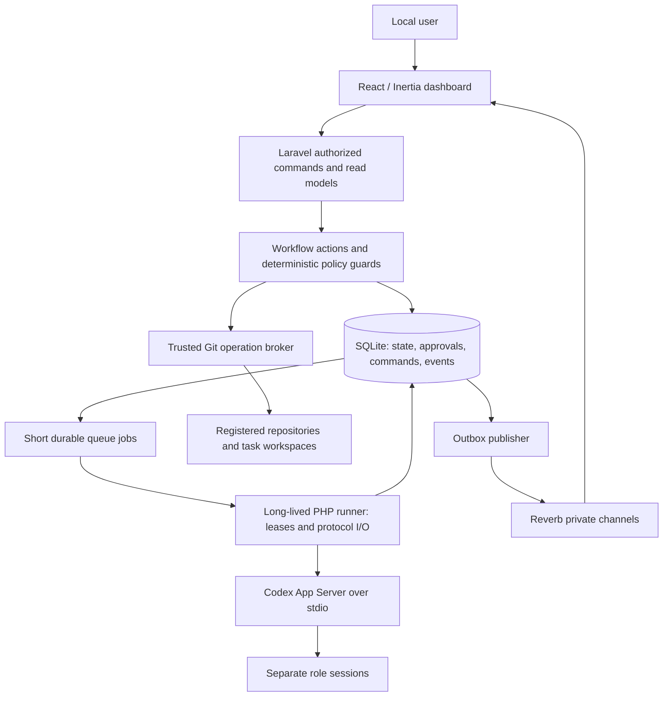

# Proposed architecture

Updated 2026-11-18. Design proposal; no implementation approval. Requirements are
in [PRD.md](PRD.md); verified capabilities and limitations in [FEASIBILITY.md](FEASIBILITY.md).

## Ownership and boundaries

Build a Laravel monolith with an independent long-lived local runner process.
Keep existing application conventions and folders. Introduce focused actions and
boundary contracts only as approved tasks need them, not a new framework within Laravel.

AI is the central reasoning decision-maker: it proposes clarification, planning,
assignments, corrections and completion. Laravel validates those proposals and owns
all actual transitions and effects. The Orchestrator cannot grant permissions,
edit code, manufacture user approval or directly invoke unrestricted Git.

## Proposed components

| Component | Responsibility | Boundary |
| --- | --- | --- |
| Workflow actions | Apply one validated command, state transition and audit event | No model call inside an open DB transaction |
| Orchestrator coordinator | Request and validate AI decisions, provide next permitted actions | Decisions are proposals, never raw executable commands |
| Context collector | Inspect relevant files/instructions and build a versioned manifest | Read-only; preserve source scope and trust level |
| Plan service | Validate structured plan, revisions, DAG and approval binding | Immutable approved revision |
| Policy evaluator | Role permissions, execution/commit eligibility, budgets and overrides | Fail closed; authoritative Laravel checks |
| Scheduler | Select ready tasks, reserve slots and assign role sessions | MVP one global execution slot; no model-created hidden work |
| Codex adapter | Normalize pinned protocol requests/events | Only this adapter knows wire field names |
| Runner | Own stdio, command journal consumption, bounded buffers, deadlines, heartbeats | No workflow policy in the transport loop |
| Git broker | Validate repository/worktree identity and execute scoped Git actions | Sole authorized repository-metadata writer |
| Verification/review services | Run approved checks and validate independent verdicts | Evidence bound to exact content snapshot |
| Timeline/read models | Paginated projections and reconnect catch-up | UI cannot alter authoritative state |

Proposed placement: actions in `app/Actions`, contracts/services in existing Laravel
`app/` conventions, jobs in `app/Jobs`, console runner in `app/Console/Commands`,
models/migrations in standard locations. Pages remain `resources/js/pages`; reuse
`resources/js/components/ui` and layouts. Final names follow sibling conventions
when each task is implemented. Use Wayfinder for frontend backend calls.

## Process model and deployment on a developer machine

Use native PHP for HTTP, queue workers, runner and Reverb. Codex runs on the same
host as the registered repositories. Existing Docker development files may remain
optional; do not put Codex inside a container and assume host paths/authentication
work. No cloud deployment or packaging installer is in MVP.

Proposed first adapter: installed Symfony Process with argument arrays and streaming
input. A runner owns one App Server process per active role session initially;
inactive persistent threads need not keep processes alive. Per-role processes simplify
permission/config separation; they cost startup time. Measure before pooling. A later
pool may share processes only between verified equivalent security profiles. Never
mix a read-only Planner and writable executor through inherited permissions.

Queue jobs record/dispatch bounded commands and return. They do not wait through
agent reasoning or human approval. A durable command table connects Laravel and
the runner, avoiding a new message broker. A polling tick and explicit deadlines
work independently of POSIX signals. Reverb failure affects live display, not work.
Native launch/stop guidance must cover terminal closure, OS sleep and orphan children.
Select a system service/OS launcher only after T02 demonstrates what is required.

## Conceptual persistence model

These are proposed entities, not migrations or an instruction to generate them now.

| Entity | Key data and relationships |
| --- | --- |
| Repository | Canonical root/common Git directory identity, allowed workspace root, base branch, trust and policy revision |
| Workflow | Repository, request revision, status, state version, active plan, human-review flag, timestamps |
| ConversationMessage | Workflow, actor, content, clarification/question link, sequence |
| ContextSnapshot | Repository/base SHA, applicable instruction paths/hashes, relevant file hashes, research references |
| PlanRevision | Objective, structured payload/schema version, immutable hash, context reference, evaluation result |
| Approval | Type, actor, target ID/hash, scope, policy revision, decision, expiry/revocation; never a generic boolean |
| Task / TaskDependency | Approved plan, scope/criteria, status, branch/worktree, dependencies, verification policy |
| AgentSession / AgentTurn | Role, task, process instance, Codex thread/turn IDs, model/effort, effective permissions and status |
| RunnerLease / RunnerCommand | Owner/fencing generation, heartbeat/expiry; idempotency key, intended effect, send/ack/reconcile state |
| PermissionRequest | Scoped wire request, process generation, tool target, decision and resolution status |
| VerificationRun | Snapshot digest, trusted argv/cwd/environment profile, exit code, duration, log/artifact hash |
| Review / ReviewFinding | Independent session, evidence digest, verdict, severity, file/line/evidence, resolution |
| GitOperation | Repository lock/generation, expected HEAD/content, operation intent/result and commit hash |
| WorkflowEvent / OutboxEntry | Durable event ID, workflow sequence, safe payload, publish state |
| UsageSnapshot / PolicySetting | Provider usage counters/provenance; versioned limits, defaults and overrides |

Use database uniqueness for workflow sequence, command idempotency and task dependency
pairs; enforce DAG validity in the plan service. Immutable artifacts carry schema and
content hashes. Large sanitized logs/diffs may live in private local storage with
database metadata, not public files. Runtime state is outside managed repositories
and never available as writable agent context.

SQLite coordination uses conditional version updates and unique constraints in
short transactions. Do not rely on row-level locks. Persist state + audit + outbox
together. Dispatch/publish only after commit; a sweeper retries missed outbox work.
Maintain local backups using a tested SQLite-aware procedure, including active WAL
state; do not copy a live database file alone and claim a recoverable backup.

## Delivery, idempotency and recovery

Every UI or runner command includes an idempotency key and expected state version.
Reserve a command/slot/lease atomically, commit, then perform I/O. An external side
effect and SQLite cannot share a transaction. Record intent before sending and
record acknowledgement after; an ambiguous send enters reconciliation. Do not
blindly resend turn starts, Git commits or permission grants after a lost response.

T06 implements the planning-command boundary in SQLite. The planning event,
journal and outbox share a transaction. The scheduled sweep processes indexed
batches of up to 100 rows per phase and checks a five-second monotonic budget
between phases. SQLite uses immediate write transactions with a one-second
lock wait. The initial command deadline is two minutes. The runner lease is renewable
for 30 seconds at a time and remains reserved after expiry. A trusted supervisor
must verify process-tree exit before releasing that generation. T07 supplies the
wire adapter and native process lifecycle.

Run `php artisan schedule:work` alongside `composer dev` for local publication
and reconciliation. An amendment that would supersede a claimed planning
command waits for acknowledgement or verified shutdown of the claiming runner.
Planning workflows that predate the journal enter reconciliation during
migration. The publication batch selects live commands by deadline so that
expired work can be reconciled without delaying publication.

Use per-repository Git locks, runner fencing generations and an OS-enforced single
writer boundary. Lease expiry alone does not stop an old process from writing: kill
or positively fence it before admitting a replacement. On lost heartbeat mark work
recovering; stop new assignments; reconcile actual thread, processes, workspace,
HEAD, pending requests and logs. Unknown state requires human intervention.

## Permissions and trust model

| Role | Project reads | Project writes | Tools / Git |
| --- | --- | --- | --- |
| Orchestrator | Relevant context or restricted read tools | Denied | Validated proposals only; no mutation tool surface |
| Planner | Relevant repository read-only | Denied, including creating planning files | Read-only allowlist; no mutating MCP/plugins/hooks |
| Executor | Approved context/worktree | Only approved task workspace | Approved test tools; Git mutations brokered; network scoped |
| Reviewer | Frozen relevant source/diff/evidence | Denied | Read-only review; tests supplied by verification runner |

Never expose raw host execution endpoints to these roles. Explicitly review inherited
Codex configuration, tools, hooks, skills, MCP servers and credential environment.
Treat claimed read-only tool annotations as insufficient proof. Controlled temporary
and Codex session storage may be writable, but project files and shared Git metadata
must remain protected for read-only roles. If the installed sandbox cannot deny
arbitrary Git metadata writes, use a verified OS isolation layer or agent checkout
without writable shared metadata and broker content transfer. This alternative needs
T02 evidence and a revised decision before execution; it is not an assumed capability.

Validate canonical paths, symlinks/junctions, drive/UNC boundaries and repository
identity at use time. Prevent executors reaching orchestrator DB/config/credentials,
other worktrees, SSH material or signing keys. Test binaries and Git hooks execute
repository code and therefore require a trusted execution profile too. Human plan
approval does not grant unrestricted host or network access.

Bind services to loopback; retain authenticated sessions and CSRF controls. Authorize
repository and workflow ownership even for a single user. Do not implement general
remote hosting in this release. Escape agent text, sanitize rendered Markdown, redact
secret values and exclude raw credentials from broadcast/log payloads.

## Git design

Select an explicit local base commit; never fetch automatically to choose it. Every
task gets a feature branch, preferably `orchestrator/<workflow>/<task>`, and isolated
workspace. Dirty registration roots may be inspected but are not mutated. Snapshot
user changes and require an explicit choice if they need to be included in context.

Freeze writers before verification and review. The evidence digest includes base SHA,
HEAD, staged/unstaged tracked content, relevant untracked files, deletions, modes and
renames; exclude only documented runtime artifacts. A text diff alone is insufficient
for binaries and untracked files. Stage an explicit verified set, never blanket add.
Check hooks/signing configuration before commit; hook-induced modifications invalidate
the evidence. Record commit intent and resulting hash; recover by inspecting actual
HEAD/tree before retry. No push, merge or deploy automation.

Later parallel work requires separate branches/worktrees and an explicit integration
step into a workflow feature branch, followed by aggregate tests and independent
review. Do not silently create unreviewed intermediate commits while auto commit is OFF.
T22 must settle patch/artifact transfer and commit permissions before parallel writes.

## Realtime and usage

Persist ordered workflow events, then broadcast minimal private-channel updates through
Reverb. Clients request events after their last sequence; duplicate/out-of-order events
are reconciled against authoritative read models. Batch high-volume tool output;
preserve bounded artifact logs, never per-token DB writes. UI contains no scheduler.

Store usage observations with thread/turn and source identity. Reconcile cumulative
counters rather than summing notifications. Show input/cache/output categories only
when reported; unknown is not zero. Optional dated API-equivalent estimates are
informational and separate from actual ChatGPT subscription billing. Limits can stop
new turns or interrupt active work; delayed reporting means a hard token/dollar ceiling
cannot be guaranteed without provider support.
