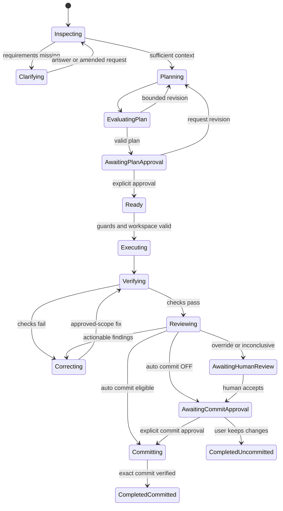

# Workflow and agent contracts

Updated 2026-11-18. Proposed behavior; implementation awaits approval.

## Core control loop

Laravel offers the AI Orchestrator only actions valid for current durable state.
Validate its structured response, then execute a guarded action. Invalid output
gets a bounded repair request or human escalation. An AI assertion that work is
approved, tested or complete never substitutes for recorded evidence.

Additional control states: `Pausing`, `Paused`, `Cancelling`, `Cancelled`,
`Recovering`, `Blocked`, `Failed`. Persist the prior phase/reason. A denied plan
can be revised or cancelled; it never advances to Ready. Every transition includes
actor, cause, expected state version and event. Terminal states retain evidence.

## Transition guards

| Boundary | Required checks |
| --- | --- |
| Inspecting -> Planning | Requirements/context sufficient; unresolved assumptions listed; tool access is read-only |
| Evaluating -> Awaiting approval | Plan schema valid, DAG acyclic, criteria testable, risks disclosed, strategy within policy |
| Awaiting approval -> Ready | User action targets exact plan/context/policy revision; no model-created approval |
| Ready -> Executing | Approval still valid; base/instructions unchanged; feature branch/workspace verified; permissions, lease and slot available |
| Executing -> Verifying | Executor finished; all writers stopped/fenced; complete content snapshot captured |
| Verifying -> Reviewing | Required checks completed and passed on that snapshot; omissions explicitly classified |
| Reviewing -> completion gate | Independent valid verdict covers snapshot/criteria; all blocking findings resolved |
| Any -> Committing | Commit policy and applicable human approval satisfied; final snapshot matches; repository lock acquired |
| Recovering -> active | Actual effects reconciled; no surviving conflicting writer; no stale approvals reused |

## Clarification and research

Inspect repository identity, architecture and relevant instructions before asking
questions. Track each question with reason, evidence already checked and affected
requirement. Ask concise conversational questions; unanswered required decisions
remain pending. Optional defaults must be visibly recorded as assumptions. A new
requirement creates a new request/context revision.

Collect applicable AGENTS/overrides and CLAUDE instructions, scoped `.ai/rules` and
relevant project skills. Codex's automatic AGENTS discovery is not assumed to discover
every CLAUDE or path-specific rule; the collector supplies missing relevant sources.
See [official instruction discovery](https://learn.chatgpt.com/docs/agent-configuration/agents-md).
Record paths, scope and hashes. Project instructions cannot override application
permission policy. Surface incompatible requirements rather than choosing silently.

Research only unresolved technical questions. Record question, source, date,
conclusion, uncertainty and reuse scope; prefer official docs. The Orchestrator or
Planner researches within its allowed tools; a dedicated research agent is exceptional.
Changes to versions/instructions invalidate only affected reusable knowledge.

## Structured contracts (application-owned, not claimed protocol schemas)

### Orchestrator decision

Required: schema version, workflow/request revision, context ID, action from the
allowed set, short rationale, referenced evidence and action-specific payload.
Actions: ask clarification, request context/research, invoke Planner, request plan
revision, present plan, propose task assignment, request review/correction, recommend
human intervention, propose final report. Laravel controls all side effects.

### Planner output

- Objective and expected outcome; functional requirements with stable IDs.
- Acceptance criteria mapped to requirements, including important failure modes.
- Relevant existing files/components and reusable patterns with evidence.
- Proposed changes and explicit excluded scope.
- Implementation tasks: ID, steps, scope/files, deliverable, criteria and dependencies.
- Acyclic dependency graph; independent task groups and justification for parallelism.
- Risks, assumptions, unanswered decisions and mitigations.
- Verification commands/checks and required evidence; environment prerequisites.
- Recommended role/model/low-medium-high effort per task, chosen from available models.
- Strategy, estimated complexity, token/time ranges and confidence; unknown estimates
  remain unknown. Parallelism defaults false and one executor is the default.

Planner returns data to Laravel; Laravel persists the plan. The Planner never writes
plan files in the target project or executes setup/implementation commands.

### Execution assignment and result

Assignment includes approved plan hash, original requirements, task criteria/scope,
instruction/context manifest, relevant dependency artifacts, branch/workspace identity,
effective permission profile, model/effort, resource limits and required checks.
Result includes actual changed files, summary, checks/artifacts, deviations, blockers
and usage observations. The executor must report scope changes before implementing
them; Laravel pauses for revised planning/approval when necessary.

### Review verdict

Required: schema version, reviewer session ID, reviewed snapshot digest, plan hash,
test-evidence hashes, criteria coverage, findings and verdict (`pass`, `changes_required`,
`inconclusive`). Findings: stable ID, severity (`critical`, `high`, `medium`, `low`),
blocking flag, description, affected path/line or other exact evidence, impact,
suggested correction and resolution status. Critical/high are blocking by default;
other findings may block acceptance. Acknowledging risk is not a fix.

Prefer native Codex review using the verified adapter. Do not confuse permission
auto-review with code review. Use a fresh read-only role session, supplied with original
requirements, approved plan/criteria, complete diff/source and trusted test results.
Validate native findings and coverage; if insufficient, use an independent structured
review turn. Parsing uncertainty cannot be converted to pass. Different model is not
required for independence; a different execution/review session and role are required.

## Approval semantics

Plan approval is an authenticated explicit action tied to plan hash, request/context
revision, repository/base SHA, execution strategy, policy revision and budget. Editing
these invalidates approval where material; narrowing permissions need not authorize
new work. Rejection, expiry and revocation are durable events. No automatic expiry
of human silence into approval. Backend rejects stale/double submissions safely.

Tool permissions are separate: identify exact session/process generation, command or
path/network scope and pending wire request. Responses are sent only while still valid.
Session-wide escalation is not a default. Unknown requests are denied or held for
human inspection. Recovery invalidates requests that cannot be matched to a live turn.

Commit approval targets the final content and evidence digest, not merely a task name.
It is distinct from plan approval and required when auto commit is OFF or human review
is required. Human approval cannot bypass required tests or unresolved blockers in the
normal completion path; an exception requires a separately approved policy change.

## Scheduling, models and budgets

Default: one executor and one global active model turn in MVP, with role turns
sequential. Multiple inactive sessions/history are allowed. A waiting human prompt
does not consume a model slot, but its workspace writer reservation remains until
the process is safely paused. Concurrency caps apply across repositories, retries,
reviews and any future children. No implicit native delegation in MVP.

| Role | Proposed model policy | Effort default |
| --- | --- | --- |
| Orchestrator | User-selected capable model available to the signed-in account | medium; high for ambiguous risk decisions |
| Planner | Capable model for architecture and dependencies | medium; high for complex changes |
| Executor | Capable coding model; lighter option only for well-bounded work | medium; low for simple edits, high for complex logic |
| Reviewer | Capable model with independent session and evidence | high for security/architecture; medium for small changes |

Discover actual model identifiers and supported effort values; never hardcode an
unverified model. Show fallback choice for approval when it materially changes budget
or strategy. Record requested and actual model if rerouting is reported.

Proposed policy defaults requiring confirmation: two repair rounds after first review,
two retries for safely retryable transient transport failures with backoff/jitter,
one structured-output repair. No repeated expensive broad research. Token/time limits
are user-configurable per workflow and session; refuse to start without a displayed
budget policy. Token overshoot remains possible with delayed usage reporting.

## Verification, correction and Git completion

The trusted verification runner invokes approved argv/cwd/environment profiles in
an isolated task workspace. Agent-provided statements and altered test scripts alone
are not sufficient evidence. Record exact commands, exit status, logs, duration and
snapshot. Require relevant tests, static checks and build checks as specified by the
plan, with narrow meaningful coverage. No tests needed for pure copy/layout changes
unless behavior changed; record why checks were omitted. No new test dependencies
without approval.

Correction assignments contain finding IDs and approved scope. Fixes invalidate prior
content-bound test/review evidence. Re-run affected checks and independent review.
Budget or loop exhaustion, conflicts or disputed findings lead to human intervention.

Commit eligibility requires all tasks complete, valid independent pass, all required
checks passed, no unresolved blocking findings, unchanged final content, no active
writers, feature branch identity, safe Git configuration and applicable approval.

| Auto commit | Human-review flag | Result after successful checks/review |
| --- | --- | --- |
| OFF | Either | Human review/explicit commit approval required |
| ON | True at workflow or any task | Human review/explicit commit approval required |
| ON | False | Laravel may commit only the verified content to the task feature branch |

Any task flag propagates to final workflow completion. Turning ON mid-workflow does
not silently authorize an already pending commit; require explicit policy adoption.
Never push, merge or deploy automatically. User may leave a successful result
uncommitted. Report branch/worktree, changed files, tests, review, usage, commit hash
or uncommitted state, and outstanding limitations.

## Pause, stop and recovery

Pause records intent, stops new assignments and requests interruption. A workflow is
Paused only after no writer remains active. Cancel preserves partial changes, logs
and workspace; never reset/delete as cancellation. Terminate interrupts first, waits
a bounded grace period, then uses a verified OS-specific process-tree operation scoped
to the known process instance. PID alone is insufficient because it may be reused.

After restart, reconcile incomplete commands against actual effects. Conversation
resume is not restoration of a live process/tool request. Preserve permissions only
where proven still valid; otherwise re-request. If a commit succeeded before the
acknowledgement was saved, inspect HEAD/tree and record the existing commit rather
than making another. Conflicting user edits, missing session history, unknown writers
or changed base/metadata produce a visible Blocked state and concrete recovery choice.
